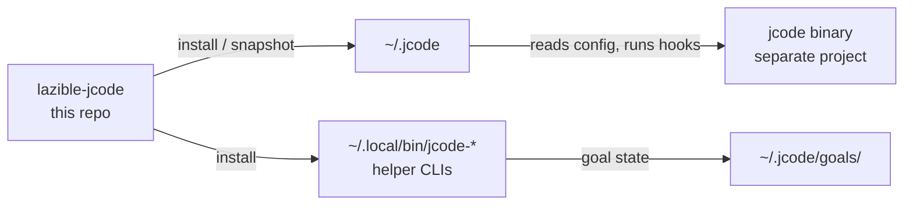
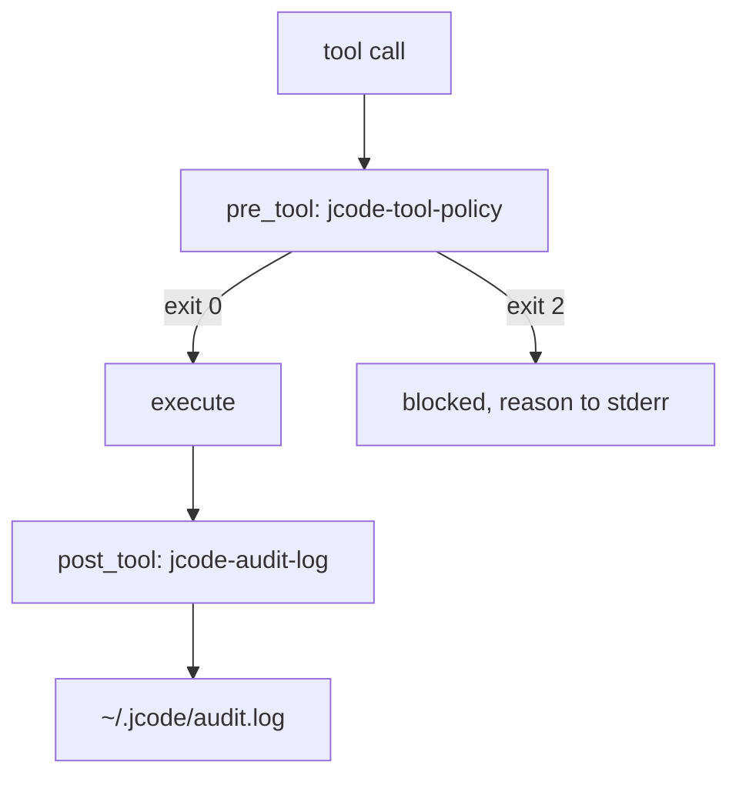
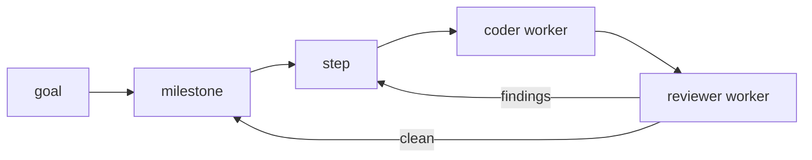

# design.md

Where this repo sits relative to jcode itself.

jcode is a separate codebase ([1jehuang/jcode](https://github.com/1jehuang/jcode)).
This repository holds configuration for it. It used to also carry a patch
pipeline on top of a fork; that is gone. What follows is the mapping between
what jcode implements and what this repo configures, plus the things this repo
deliberately does not do.

## 1. Ownership boundary

| Concern | Owner |
| --- | --- |
| Binary behavior, providers, TUI, swarm | jcode |
| `~/.jcode/config.toml` values | this repo |
| Skills, helper CLIs, hook scripts | this repo |
| Goal and milestone state | this repo (`jcode-goal`, `jcode-orchestrate`) |
| Anything requiring a Rust change | jcode |

If a need lands in the bottom row twice, it is a jcode feature request, not a
config change. Keep it out of this repo.

## 2. Config field mapping

`config/config.toml` is copied verbatim into `~/.jcode/config.toml`. The
non-obvious entries, and why they hold the value they do:

| Field | Value | Reason |
| --- | --- | --- |
| `hooks.pre_tool` | `jcode-tool-policy` | Synchronous gate. Exit 2 blocks the tool call. |
| `hooks.post_tool` | `jcode-audit-log` | Observer only. jcode does not wait on it, it cannot block. |
| `hooks.pre_tool_timeout_ms` | `8000` | The policy is a few file reads; anything slower means a hang. |
| `agents.swarm_spawn_mode` | `headless` | `inline`/`visible` try to spawn a kitty window. Ambient cycles run detached. |
| `agents.memory_sidecar_enabled` | `true` | Enables `/remember`. |
| `agents.memory_rerank_cadence` | `3` | Rerank every 3rd write. Higher costs more. |
| `ambient.enabled` | `true` | The point of the setup. |
| `ambient.allow_api_keys` | `true` | Ambient cycles need provider access. |
| `ambient.max_interval_minutes` | `30` | `jcode-l2-check` fails above 60. |
| `ambient.visible` | `false` | `runner.rs:891` picks `run_cycle_direct`. `true` waits on TUI interaction every cycle. |
| `safety.ntfy_topic` | `""` | Empty on purpose. Real value comes from `JCODE_NTFY_TOPIC`. |
| `compaction.mode` | `semantic` | Summarization-based context management. |

Field names are the ones jcode's config types use. `scripts/verify-sanitized`
parses the file with `tomllib`, so an unknown field is a silent no-op until
jcode reads it.

## 3. Hook contract

- `pre_tool` is synchronous. jcode reads the exit code: `0` allows, `2`
  rejects.
- `post_tool` is fire-and-forget. A failure there cannot affect the tool call.
- Hooks receive their inputs through environment variables
  (`JCODE_HOOK_EVENT`, `JCODE_HOOK_TOOL_NAME`, `JCODE_HOOK_STATUS`,
  `JCODE_HOOK_DURATION_MS`, `JCODE_HOOK_OUTPUT_BYTES`, `JCODE_HOOK_CWD`,
  `JCODE_HOOK_PAYLOAD`). See `jcode-base/src/hooks.rs`.

What `jcode-tool-policy` enforces is listed in
[`config/policies/git.md`](config/policies/git.md).

## 4. Autonomy levels

Defined in [`config/policies/autonomy.md`](config/policies/autonomy.md). This
repo ships L2. There is no profile mechanism: one file, one level, edit and
reinstall.

## 5. Goal-driven loop

`jcode-orchestrate` owns this state machine. Two properties worth knowing:

- **Coder and reviewer are never the same session.** Distinct `session_id`,
  distinct label prefixes, and the reviewer prompt forbids code changes.
- **A parse-failed verdict is conservative.** If the reviewer output cannot be
  parsed, the milestone is re-queued with confidence `0.0` rather than accepted.

Retry budgets and escalation are in
[`config/policies/repair-loop.md`](config/policies/repair-loop.md).

## 6. Known gaps

These need a jcode change. They are listed so nobody re-adds a workaround here.

| Gap | Where it lives |
| --- | --- |
| No per-repo config override. Every session shares `~/.jcode/config.toml`. A gitignored `.jcode/config.local.toml` read at startup would fix it. | needs a config-types field |
| No worktree auto-selection. `SwarmSpawnMode` decides how a worker is displayed, not where it runs. | needs swarm-core logic |
| `requeue_failed` retry ceiling is not configurable. | `jcode-plan/src/dag/ops.rs` |
| No L0 allowlist or y/N prompt in the shipped policy. | policy script, could be added here |
| No compaction-before-tool mechanic in jcode itself. | model-dependent, not wired |

## 7. History

- `new.md` — the original vision, kept as written. Sections describing multiple
  config profiles describe an approach this repo no longer uses.
- [`notes/`](notes/) — two notes that still describe current behavior.
  Everything else moved to git history.